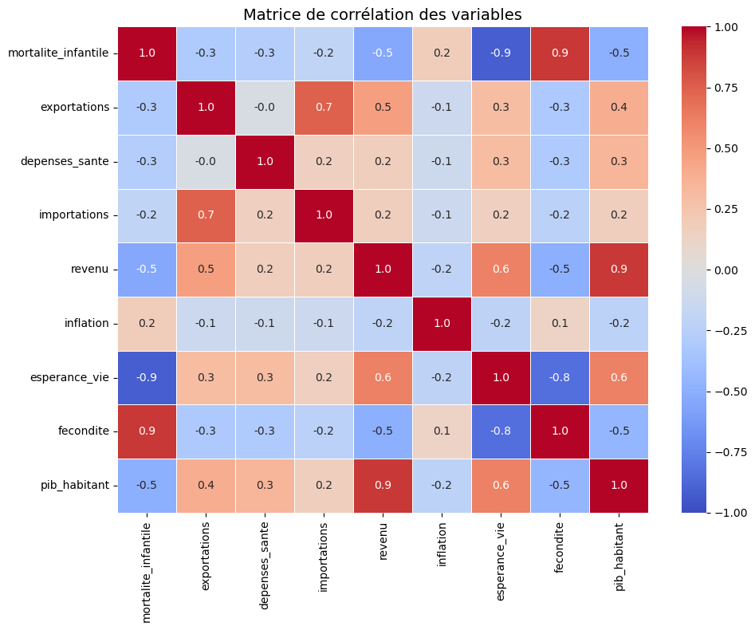
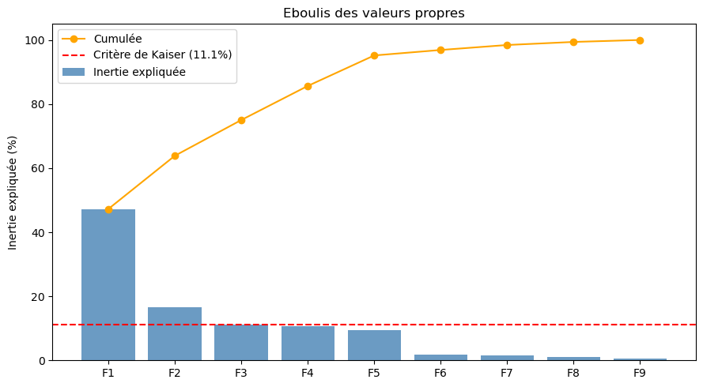
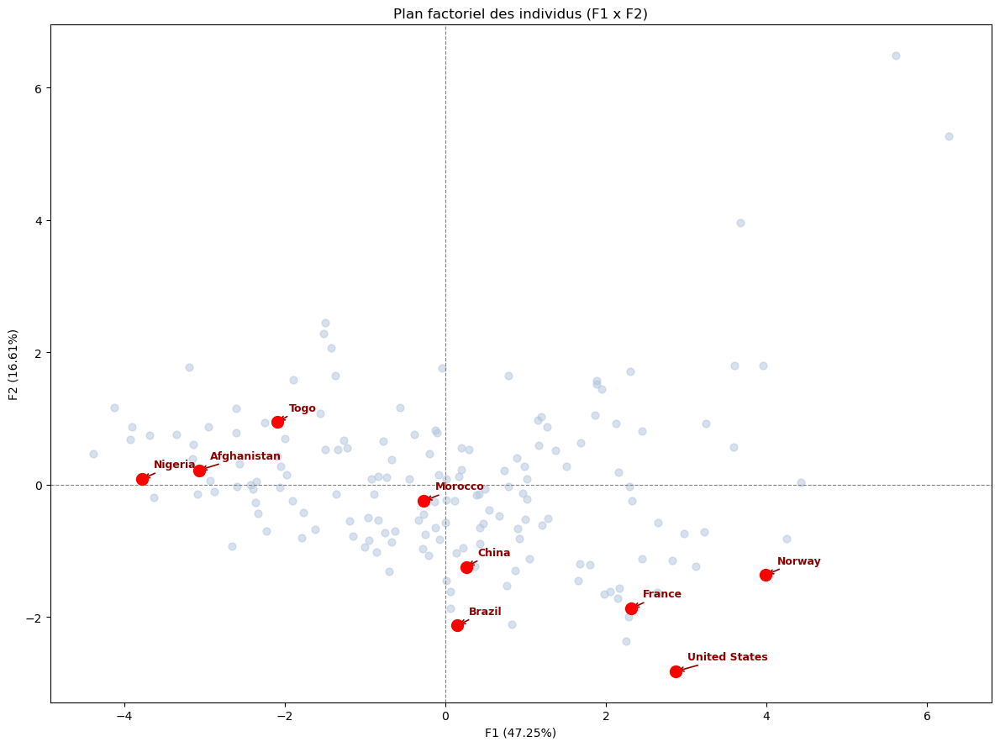
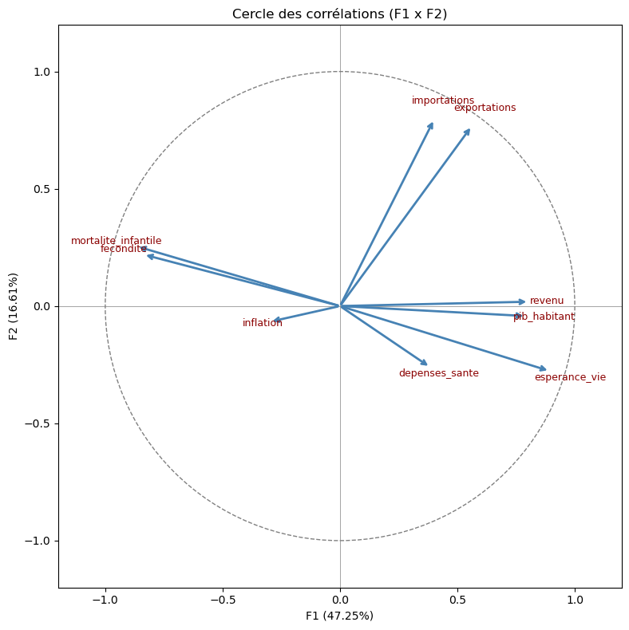

# Analyse en composantes principales des indicateurs socio-économiques

> Une analyse exploratoire de 169 pays à partir de neuf indicateurs économiques et sanitaires, avec Python et l’ACP.

## Résultats clés

- **F1 : 47,25 %** de l’inertie expliquée.
- **F2 : 16,61 %**.
- **F1 et F2 : 63,86 %** au total.
- **F1** oppose principalement les pays aux revenus et à l’espérance de vie élevés aux pays où la mortalité infantile et la fécondité sont élevées.
- **F2** est surtout associé aux échanges commerciaux, notamment aux exportations et aux importations.

Les résultats sont exploratoires : les deux premiers axes résument une part importante des données, mais pas leur totalité.

## Objectif

Ce projet applique l’analyse en composantes principales (ACP) à des indicateurs socio-économiques afin de résumer les données, d’étudier les liens entre les variables et de comparer les profils des pays. Les variables étant exprimées dans des unités différentes, elles sont centrées et réduites avant l’analyse.

## Données

Le fichier [`donnees_pays.csv`](./donnees_pays.csv) contient le nom des pays et neuf indicateurs :

| Variable | Description |
|---|---|
| `mortalite_infantile` | Mortalité infantile pour 1 000 naissances |
| `exportations` | Exportations en pourcentage du PIB |
| `depenses_sante` | Dépenses de santé en pourcentage du PIB |
| `importations` | Importations en pourcentage du PIB |
| `revenu` | Revenu moyen par habitant, en dollars |
| `inflation` | Taux d’inflation annuel |
| `esperance_vie` | Espérance de vie, en années |
| `fecondite` | Nombre moyen d’enfants par femme |
| `pib_habitant` | PIB par habitant, en dollars |

Les lignes contenant des valeurs manquantes sont retirées dans le notebook avant les calculs.

## Aperçu des figures

Les figures suivantes sont intégrées au dépôt. Cliquez sur une image pour l’ouvrir en taille réelle.

### Matrice de corrélation

Elle montre les relations positives ou négatives entre les indicateurs.

[](./images/matrice-correlation.png)

### Éboulis des valeurs propres

Il présente la part d’inertie expliquée par chaque axe et la part cumulée.

[](./images/eboulis-valeurs-propres.png)

### Plan factoriel des pays (F1 × F2)

Il représente les pays selon leurs coordonnées sur les deux premiers axes.

[](./images/plan-factoriel-pays.png)

### Cercle des corrélations

Il montre les liens entre les variables et les axes factoriels.

[](./images/cercle-correlations.png)

Les calculs et le code qui produisent ces figures sont disponibles dans [`ACP.ipynb`](./ACP.ipynb). Les coordonnées des pays et des variables doivent être interprétées en tenant compte de leur qualité de représentation sur le plan F1 × F2.

## Méthode

Le notebook suit ces étapes :

1. Charger le fichier CSV et retirer les lignes contenant des valeurs manquantes.
2. Sélectionner les variables numériques.
3. Centrer et réduire les variables afin de les rendre comparables.
4. Calculer la matrice de corrélation.
5. Calculer les valeurs propres et les vecteurs propres.
6. Calculer les composantes principales et produire les visualisations.
7. Examiner la qualité de représentation et la contribution des variables et des pays.

La standardisation est effectuée selon la formule :

$$
z_{ij} = \frac{x_{ij} - \bar{x}_j}{\sigma_j}
$$

## Interprétation synthétique

### Axe F1 — développement socio-économique et sanitaire

F1 est principalement associé à l’espérance de vie, au revenu et au PIB par habitant. Il s’oppose à la mortalité infantile et à la fécondité. Dans cette analyse, les pays ayant une coordonnée positive sur F1 tendent donc à présenter des indicateurs de niveau de vie et de santé plus élevés. Ceux ayant une coordonnée négative tendent à présenter une mortalité infantile et une fécondité plus élevées.

### Axe F2 — échanges commerciaux

F2 est surtout associé aux exportations et aux importations. Il apporte une information complémentaire sur les échanges commerciaux, distincte de l’opposition principale observée sur F1.

### Limites de lecture

Les deux premiers axes expliquent **63,86 %** de l’inertie : une partie de l’information reste donc portée par les axes suivants. De plus, la position d’une variable ou d’un pays sur le plan F1 × F2 est à interpréter avec prudence si sa qualité de représentation sur ce plan est faible. Le signe des axes est arbitraire ; ce sont les oppositions entre les côtés de chaque axe qui comptent.

## Installation et exécution

### Prérequis

- Python 3
- Jupyter Notebook ou JupyterLab

### Installer les bibliothèques

Dans un terminal, depuis le dossier du projet :

```bash
python -m pip install pandas numpy matplotlib seaborn jupyter
```

### Lancer le notebook

```bash
jupyter notebook ACP.ipynb
```

Il est aussi possible d’ouvrir `ACP.ipynb` dans JupyterLab ou dans Visual Studio Code. Vérifiez que `donnees_pays.csv` se trouve dans le même dossier que le notebook, puis exécutez les cellules dans l’ordre.

## Structure du projet

```text
ACP/
├── ACP.ipynb
├── donnees_pays.csv
├── README.md
└── images/
    ├── matrice-correlation.png
    ├── eboulis-valeurs-propres.png
    ├── plan-factoriel-pays.png
    └── cercle-correlations.png
```

## Technologies

- Python
- pandas
- NumPy
- Matplotlib
- Seaborn
- Jupyter Notebook

## Source des données

Le notebook indique que les données proviennent de la Banque mondiale / Kaggle. Pour réutiliser ou redistribuer le jeu de données, consultez la source d’origine et ses conditions d’utilisation.
